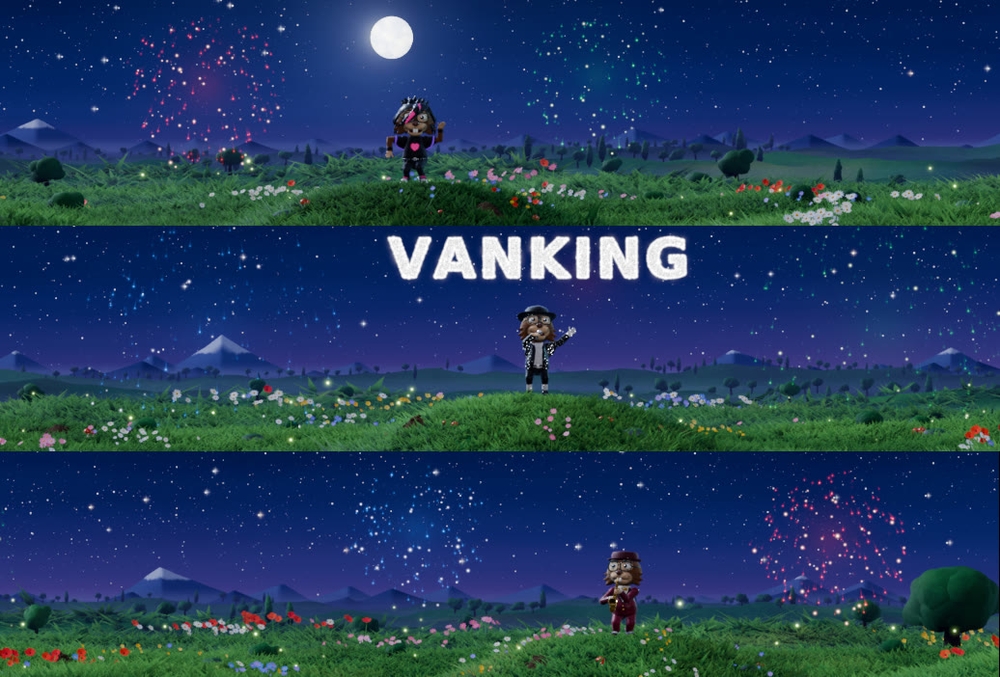
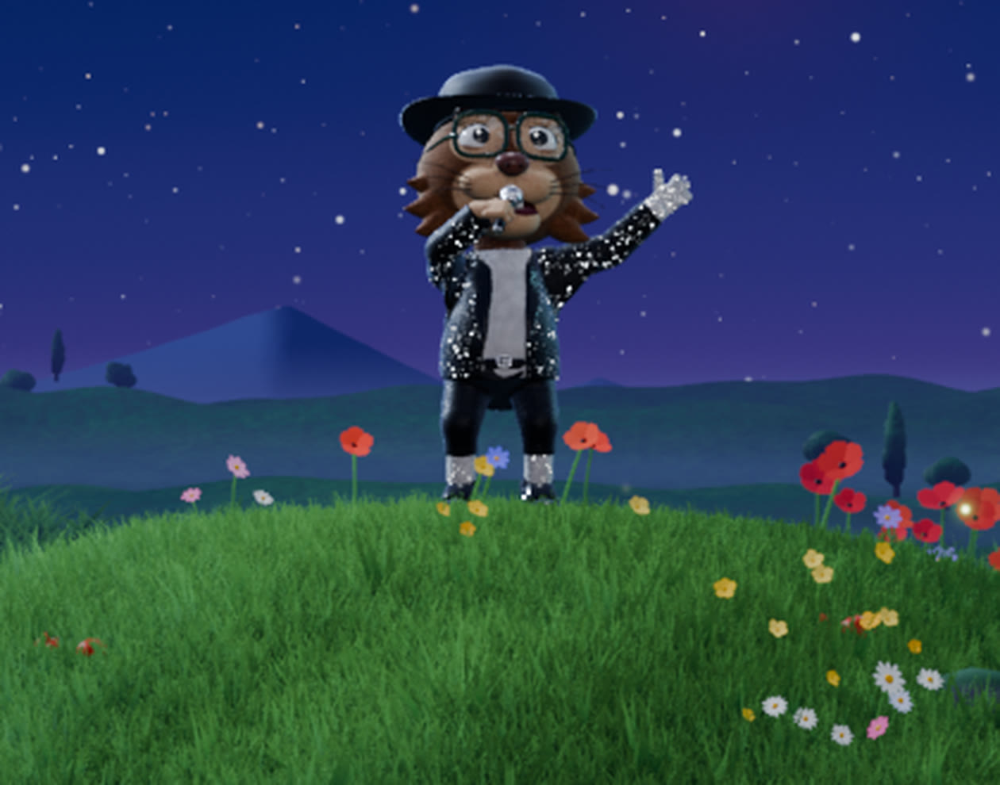
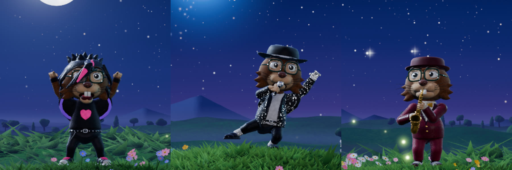

# VANKING.UZ — Mole Music Show (Video1s)

A **15-second, seamlessly looping** 3D concert for a three-screen LED wall: three VANKING.UZ mole
mascots perform on three grassy hills under a starry evening sky, while blue, red and green
fireworks launch every four seconds and their sparks assemble into the glowing white word
**VANKING**.



*Draft-quality panorama (1/8 size) rendered in the development sandbox, cut into three rows: left,
centre and right part of the wall.*



* Specification: [`docs/TECHNICAL_SPECIFICATION_VANKING.UZ.txt`](docs/TECHNICAL_SPECIFICATION_VANKING.UZ.txt)
* Progress log: [`PROGRESS.md`](PROGRESS.md) · what to do next: [`NEXT_STEPS.md`](NEXT_STEPS.md)
* How the scene is built: [`blender/README.md`](blender/README.md)
* Brand source art (official mascot SVGs): [`assets/brand/`](assets/brand)

## Status

The show is a real 3D scene generated by Python in **Blender 4.5 LTS** (there are no `.blend` files).
The scene, the three characters with their costumes and choreographies, the fireworks and the whole
render pipeline are complete and were checked in the development sandbox at reduced size.
**The full-size render has to be made on a Mac** (the sandbox has no GPU): see the commands below
and the list of things that could only be verified there in [`PROGRESS.md`](PROGRESS.md).

## Render it on a Mac (Apple Silicon)

```bash
git clone --branch vorflux/blender-3d-rework https://github.com/wankinguz-blip/Video1s.git
cd Video1s
brew install ffmpeg
scripts/show.sh setup      # downloads Blender 4.5.16 LTS into tools/ (does not touch /Applications)
scripts/show.sh test       # three stills at 1/4 size                -> out/test/panorama_t02_500.png
scripts/show.sh bench      # two full-size frames of the widest screen: time per frame, estimate for `final`
scripts/show.sh preview    # low-resolution panorama video with sound -> out/preview/VANKING_panorama_preview.mp4
scripts/show.sh final      # all frames of the three screens + videos -> deliverables/
```

The repository is private, so `git clone` needs GitHub authorisation (for example `gh auth login`).
After the branch is merged, `--branch vorflux/blender-3d-rework` is no longer needed.

* Rendering can be interrupted with Ctrl-C; the same command continues where it stopped (finished
  frames are skipped). `scripts/show.sh frames center` renders one screen only.
* `JOBS=2 scripts/show.sh final` runs two Blender processes; `SAMPLES=16` halves the render time at
  the cost of slightly noisier soft shadows; `EXTRA="--grass 0.5"` halves the number of grass tufts.
* `scripts/show.sh validate` checks that the loop closes, `scripts/show.sh seams` that the three
  screens join into one picture. All commands and options: `scripts/show.sh help`.
* If something fails, the complete Blender output is in `out/logs/render.log`.

`final` writes into `deliverables/`:

| File | Content |
| --- | --- |
| `VANKING_left_6864x1872.mp4` | left screen — emo Tecktonik dancer |
| `VANKING_center_11752x1872.mp4` | centre screen — lead singer, the word VANKING |
| `VANKING_right_6240x1872.mp4` | right screen — saxophonist |
| `VANKING_panorama_preview.mp4` | the three screens side by side, 3840 px wide, for review |

Video: H.264 High, yuv420p (BT.709), 30 fps, exactly 450 frames (15.000 s), CRF 16; audio: AAC
320 kb/s from [`deliverables/soundtrack.wav`](deliverables/soundtrack.wav). The PNG frames stay in
`out/frames/` and can be encoded to another codec for a media server. For gap-free audio looping use
the WAV itself (48 kHz, exactly 720 000 samples): AAC in MP4 adds priming samples.

## The wall

The three screens are windows of **one** panorama of 24 856 × 1872 px, left to right:

| Screen | Size | Character |
| --- | ---: | --- |
| Left | 6864 × 1872 | Emo Tecktonik dancer |
| Centre | 11 752 × 1872 | Lead singer; the word VANKING forms above him |
| Right | 6240 × 1872 | Jazz saxophonist |

All three are lens-shifted slices of the same camera, so the picture continues across the seams.
(The order of the two side screens follows the customer's decision of 2026-11-14.)

## What happens

| Time | Events |
| --- | --- |
| 0.0–1.0 s | All three moles are already performing; rockets rise from behind the hills. |
| 1.0–2.0 s | Blue, red and green bursts; part of their sparks turn white and fly into the letters. |
| 2.0–3.0 s | **VANKING** holds for one second, shimmering. |
| 3.0–4.0 s | The letters crumble left to right; the sparks fall, shrink and fade above the characters. |
| 4–8 s, 8–12 s | Second and third cycle with other colour orders. |
| 12–15 s | Compressed fourth cycle (burst 12.5 s, hold 13.25–14.25 s, gone by 14.93 s) → loops into 0 s. |

| Hill | Character | Costume | Performance |
| --- | --- | --- | --- |
| Centre | Lead singer | black sequinned jacket, white tee, black trousers, white socks, loafers, one sparkling white glove, black fedora, microphone | lip-synced singing, sky points, toe taps, heel-and-toe swivels, a foot slide, hat pinch, side kick, full spin |
| Right | Saxophonist | burgundy suit, cream shirt, golden bow tie, pork-pie hat, two-tone shoes, golden alto saxophone | fingering and puffed cheeks follow the notes of the score, sways, knee dips, lifts the horn on accents, eyes close on long notes |
| Left | Emo dancer | black tee with a pink heart, skinny jeans, studded belt with chain, wristbands, sneakers with pink laces, long fringe with a pink streak | Tecktonik: forearm rolls, alternating windmills round the head, cross-body slices, angular locks, arm waves, heel swivels, jumps, a spin; fastest combinations on the bursts |



The soundtrack (120 BPM pop-funk with saxophone, talk-box vocal and firework sounds) is synthesised
by `audio/build-soundtrack.mjs` from `src/music/score.js`. The same score drives the lip-sync, the
saxophone fingering and the dance accents (`blender/data/score.json`).

## Why the loop and the seams are exact

* Every moving thing is a pure function of the loop time `t` with a period of 15 s: analytic IK for
  the characters, closed-form trajectories for every firework spark, integer numbers of wind and
  twinkle cycles. There is no simulation and no state between frames, so frame 450 is frame 0 and
  frames can be rendered in any order.
* One camera for the whole wall; a screen only changes the lens shift and the resolution. No
  compositor, bloom, screen-space effects or volumetrics (they depend on the frame borders): glow is
  additive geometry.
* Checks (run in the sandbox on the complete scene, panorama at 1/8 size):
  `scripts/show.sh validate` → t = 0 and t = 15 identical, step 449→0 equals an ordinary frame step
  (ratio 0.99): **PASS**; `scripts/show.sh seams` → three screens vs one panorama differ only by
  sample noise, also in the seam columns: **PASS**;
  `blender/dev/check_choreo.py` → continuity, loop closure, collisions, foot sliding and prop
  contacts of all three routines: **PASS**.

## Repository layout

```
scripts/show.sh          the render pipeline (setup, test, bench, preview, final, validate, seams …)
blender/render.py        render driver: slices, frame ranges, resume, parallel parts
blender/vk/              the scene: config, camera, terrain, environment, lighting, fireworks,
                         rig + skinning, mole model, outfits, props, choreographies (vk/choreo/)
blender/dev/             checks and look-dev tools (pose sheets, stick-figure sheets, statistics …)
blender/data/            score and text targets exported for Blender (no Node needed to render)
audio/, src/             soundtrack generator and the shared score / timing / text data
deliverables/            soundtrack.wav; the final videos are written here
docs/                    specification, preview pictures
legacy/2d/               the first, rejected 2.5D canvas version (kept for reference)
```

Regenerating the data (only needed after changing the music): `npm install`,
`node audio/build-soundtrack.mjs`, `node scripts/export-blender-data.mjs`.
